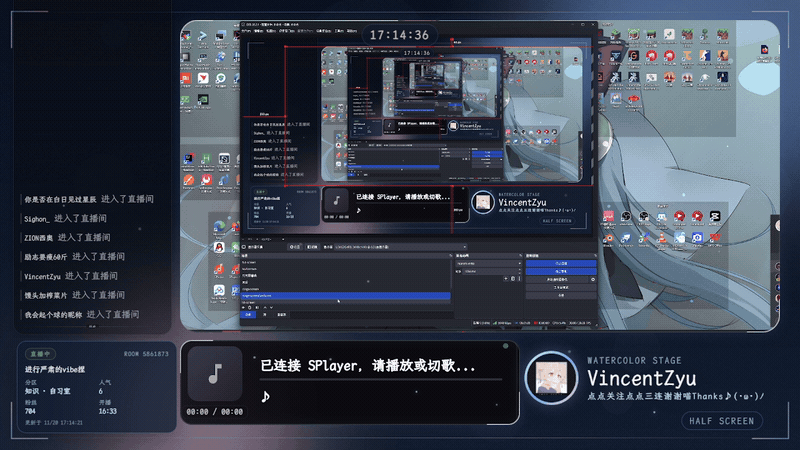

# obs-manim-like-motion

> **Manim-inspired kinetic transitions and animation effects for OBS Studio.**

> **[📖 English](README.en-us.md)**
> **[📖 简体中文(大陆)](README.md)**

Bringing the mathematical elegance, dynamic rate functions, and geometric construction animations from **[Manim](https://github.com/ManimCommunity/manim)** directly into **OBS Studio**.

<p align="center">
  
</p>

---

## 🌟 Highlights

- **$M \times N$ Cartesian Product Transition Architecture**:
  - Independent **Exit**, **Pause**, and **Entrance** phases decoupled on the normalized time pipeline.
  - Mix and match any exit and entrance animation inside OBS transition properties.
- **Exit Animations**:
  - `FadeOut`: Kinetic acceleration exit based on Manim's `rush_into` with subtle scale-down dynamics.
  - `Uncreate`: Geometric deconstruction—scene colors dissolve outward, revealing glowing wireframe contours that rewind/dissolve.
  - `Unwrite` (Rewind Handwriting Erasure · v0.3.0): Erases previous scene backwards along spatio-temporal flow field with glowing stroke tips.
- **Entrance Animations**:
  - `FadeIn`: Kinetic deceleration landing based on Manim's `rush_from` with smooth settling dynamics.
  - `Create` (`DrawBorderThenFill`): High-intensity outline drawn on canvas perimeter and internal scene elements, followed by a fluid color fill wave.
  - `Write` (Spatio-Temporal Handwriting · v0.3.0): Replicates classic Manim mathematical derivation handwriting. Supports Natural LTR, Boustrophedon snake scan, Vertical code waterfall, Diagonal sweep, and Polar logarithmic spiral (`SpiralIn`), backed by `lag_ratio` infill delays and pen tip sparkles.
- **Real-Time GPU Contour Extraction**:
  - Utilizes 3x3 Scharr gradient operators and Fourier harmonic wave modulation to transform any real-time screen into high-contrast chalkboard sketches in sub-millisecond shader passes.
  - 3-way mode switch: **`GPU Real-Time Sketch (XDoG)`**, **`Fourier Harmonic Waves`**, and **`Disabled (Border Only)`**.
- **Stroke Color Preset Palette**:
  - 7 preset themes (Mizuiro mist blue `#7FA8E8`, Ice Blue `#DCEBFF`, Chalk White `#FFFFFF`, Math Gold `#FFD700`, Ribbon Pink `#F4C6D7`, Cream White `#FFF3DE`, Cyber Neon Cyan `#00FFFF`) plus custom RGBA color picker.
  - Instant synchronization between dropdown presets and native OBS color swatch.
- **Fine-Grained Dynamic Controls**:
  - Contour Sensitivity & Fill-In Delay sliders.
  - Exit timing split ratio & pause gap duration.
  - Border stroke thickness & glow multiplier.
- **Zero Local Overhead**:
  - Pure GPU rendering via HLSL shaders (`.effect`) in modern C++20.
  - Automated cloud builds for **Windows x64** and **Linux x64** via GitHub Actions CI.

---

## 🛠️ Automated CI/CD & Build Workflow

Cross-platform builds and releases are automated via GitHub Actions, featuring a `winload`-style commit keyword gating mechanism to prevent daily commits from consuming compute resources. For detailed trigger guides, please refer to:
* 📖 [Build & Release Workflow (.github/workflows/build.en-us.md)](.github/workflows/build.en-us.md)

---

## 🛠️ Download & Installation

### Official Releases (GitHub Releases)
Head over to the **[Releases](https://github.com/VincentZyuLive/obs-manim-like-motion/releases)** page to download the latest prebuilt packages.

### 📦 Release Archive Directory Structures & Target Layouts

Every release provides multiple packaging flavors tailored for different deployment environments and operating systems. Below are the internal folder layouts and recommended destinations:

#### 1. `obs-manim-motion-<version>-windows-x64.zip` (Standard Root Overlay Package)
* **Directory Structure**:
  ```text
  obs-manim-motion-<version>-windows-x64.zip
  ├── obs-plugins/
  │   └── 64bit/
  │       └── obs-manim-motion.dll
  └── data/
      └── obs-plugins/
          └── obs-manim-motion/
              ├── locale/
              │   ├── en-US.ini
              │   └── zh-CN.ini
              └── effects/
                  └── manim_transition.effect
  ```
* **Target Layout & Installation**:
  * **Classic OBS Installation Directory Overlay** (typically `C:\Program Files\obs-studio\`).
  * Simply extract the zip archive directly into your OBS root installation directory. The top-level `obs-plugins/` and `data/` directories will seamlessly merge with OBS's native directory structure.

#### 2. `obs-manim-motion-<version>-windows-x64-OBS33.zip` (OBS 33+ Modern Modular Package)
* **Directory Structure**:
  ```text
  obs-manim-motion-<version>-windows-x64-OBS33.zip
  └── plugins/
      └── obs-manim-motion/
          ├── bin/
          │   └── 64bit/
          │       └── obs-manim-motion.dll
          └── data/
              ├── locale/
              │   ├── en-US.ini
              │   └── zh-CN.ini
              └── effects/
                  └── manim_transition.effect
  ```
* **Target Layout & Installation**:
  * **Modern self-contained plugin structure introduced in OBS Studio 33.0+**. OBS 33+ supports placing each plugin in its own subfolder under `plugins/` for cleaner upgrades and uninstallation.
  * Extract into your OBS installation root directory (merging with the root `plugins/` directory), or copy the inner `obs-manim-motion/` folder into your user data directory.

#### 3. `obs-manim-motion-<version>-windows-x64-programdata.zip` (Non-Admin / AppData Portable Package)
* **Directory Structure**:
  ```text
  obs-manim-motion-<version>-windows-x64-programdata.zip
  └── obs-manim-motion/
      ├── bin/
      │   └── 64bit/
      │       └── obs-manim-motion.dll
      └── data/
          ├── locale/
          │   ├── en-US.ini
          │   └── zh-CN.ini
          └── effects/
              └── manim_transition.effect
  ```
* **Target Layout & Installation**:
  * **Environments without administrator rights / Steam OBS / Portable OBS installations**. Requires no write permissions to `C:\Program Files`.
  * Extract the root `obs-manim-motion/` folder into either of the following paths:
    * **Current User AppData Directory (Recommended)**:
      `%APPDATA%\obs-studio\plugins\obs-manim-motion`
      (i.e. `C:\Users\<Username>\AppData\Roaming\obs-studio\plugins\obs-manim-motion`)
    * **Shared All-Users ProgramData Directory**:
      `C:\ProgramData\obs-studio\plugins\obs-manim-motion`

#### 4. `obs-manim-motion-<version>-x86_64-linux-gnu.deb` (Debian / Ubuntu Package)
* **Installed Files**:
  * Binary: `/usr/lib/x86_64-linux-gnu/obs-plugins/obs-manim-motion.so`
  * Assets & Shaders: `/usr/share/obs/obs-plugins/obs-manim-motion/`
* **Target Layout & Installation**:
  * Compatible with Ubuntu, Debian, Linux Mint, Pop!_OS, and derivatives.
  * Install via terminal: `sudo dpkg -i obs-manim-motion-*.deb` or `sudo apt install ./obs-manim-motion-*.deb`.

#### 5. `obs-manim-motion-<version>-linux-x86_64.tar.gz` / `.zip` (Generic Linux Portable Tarball)
* **Directory Structure**:
  ```text
  ├── lib/
  │   └── obs-plugins/
  │       └── obs-manim-motion.so
  └── share/
      └── obs/
          └── obs-plugins/
              └── obs-manim-motion/
                  ├── locale/
                  └── effects/
  ```
* **Target Layout & Installation**:
  * Suitable for Arch Linux, Fedora, openSUSE, SteamOS (Steam Deck), and other generic Linux distros.
  * **System-wide**: Extract into `/usr/local/`.
  * **User-level**: Place `lib/obs-plugins/obs-manim-motion.so` under `~/.config/obs-studio/plugins/obs-manim-motion/bin/64bit/`, and data under `~/.config/obs-studio/plugins/obs-manim-motion/data/`.

---

### Quick Start Guide

After installation, launch OBS Studio, click the **`+`** button in the **Scene Transitions** dock, and choose **Manim Motion**!

> [!TIP]
> **Plugin Update Notice**: If you replace or upgrade plugin files (`.dll`, `.so`, or `.effect` shader assets) while OBS Studio is running, **you must restart OBS Studio** to load the newly updated binaries, property UI controls, and effect shaders.

---

## 📜 License

GPL-2.0-or-later.
