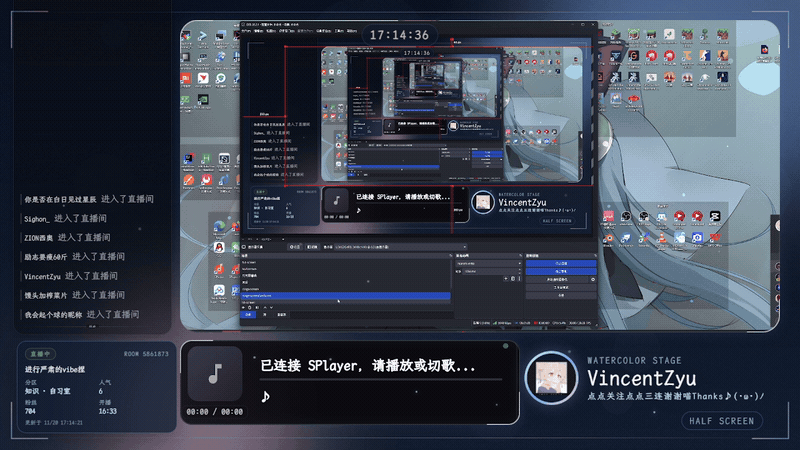

# obs-manim-like-motion

> **将 Manim 数学动画哲学与动力学曲线引入 OBS Studio 的高质量转场与动效插件。**

> **[📖 English](README.en-us.md)**
> **[📖 简体中文(大陆)](README.md)**

本项目受数学动画引擎 **[Manim (Community Edition)](https://github.com/ManimCommunity/manim)** 启发，将 Manim 标志性的缓动速度曲线（Rate Functions）、几何勾勒与两段式构建动效带入 OBS 场景转场与画面呈现中。

<p align="center">
  
</p>

---

## 🌟 核心特性

- **$M \times N$ 笛卡尔积解耦转场架构**：
  - 将转场时间轴解耦为**出场阶段（Exit）**、**微顿歇（Pause）**与**入场阶段（Entrance）**。
  - 用户可在单个转场属性面板中自由搭配任意出场与入场动效，形成灵活组合。
- **退出动效清单（Exit）**：
  - `FadeOut`（动力学加速淡出）：基于 Manim 的 `rush_into` 曲线，配合微缩下沉动力学，干净利落。
  - `Uncreate`（线框反向解构）：画面内部先向外消解，边缘与元素留存高光线稿骨架，随后逆时针/向中心收拢消散。
  - `Unwrite`（倒带式手绘擦除 · v0.3.0）：沿时空流场反向抹除画面，伴随笔尖高光微斑与线稿时差褪色。
- **入场动效清单（Entrance）**：
  - `FadeIn`（动力学阻尼冲入）：基于 Manim 的 `rush_from` 曲线，带有自然的阻尼刹车回弹质感。
  - `Create`（`DrawBorderThenFill` 勾勒后填充）：暗场中先由高光线稿勾勒出所有文字、边框与主体轮廓，随后画面真实色彩如墨水般由内向外注入浸润。
  - `Write`（时空流场手写演算 · v0.3.0）：复刻 Manim 经典的文字手绘推导过程，支持自然逐行横排、折返蛇形、代码瀑布、对角光幕与极坐标螺旋（`SpiralIn`）5 种流向，以及细致的 `lag_ratio` 时差滞后与笔尖火花。
- **GPU 实时几何轮廓素描场（Contour Extraction）**：
  - 采用 3×3 Scharr 梯度卷积算子与频域谐波算法，无需矢量字体或离线预处理，单 Shader Pass 直接在毫秒内将实时画面转换为数学黑板手绘线稿。
  - 提供 **`GPU 实时线稿素描 (XDoG 算子)`**、**`频域傅里叶谐波`** 与 **`关闭 (仅保留外边框)`** 3 种模式下拉切换。
- **线稿高光画风预设矩阵（Color Preset）**：
  - 提供 7 种经典调色预设（水色雾蓝 `#7FA8E8`、冰蓝微光 `#DCEBFF`、经典粉笔白 `#FFFFFF`、黄金流光 `#FFD700`、缎带柔粉 `#F4C6D7`、奶油温白 `#FFF3DE`、赛博霓虹青 `#00FFFF`）以及自定义 RGBA 拾色器。
  - 下拉选单与原生调色板即时联动同步。
- **精细化动力学与节奏调节**：
  - 轮廓提取灵敏度（Contour Sensitivity）、色彩浸润注入延迟（Fill-In Delay）。
  - 出场/入场占比（Timing Split）、顿歇停顿微空隙（Pause Duration）。
  - 边框线条粗细（Border Thickness）、发光强度倍率（Glow Multiplier）。
- **零本地环境负担**：
  - 核心逻辑基于现代 C++20 与 `libobs` 架构，渲染层全由 GPU 像素着色器（HLSL `.effect`）实时处理，开销极低。
  - 依托 GitHub Actions 自动化 CI，覆盖 **Windows x64** 与 **Ubuntu Linux x64** 的云端编译与打包。

---

## 🛠️ 自动化构建与 CI/CD

本项目通过 GitHub Actions 实现了全自动跨平台构建与发布流水线，采用与 `winload` 一致的提交关键字门禁机制，避免日常提交消耗计算资源。详细触发指南请参阅：
* 📖 [构建与发布工作流说明 (.github/workflows/build.md)](.github/workflows/build.md)

---

## 🚀 下载与安装

### 获取正式发布版（GitHub Releases）
请前往项目的 **[Releases](https://github.com/VincentZyuLive/obs-manim-like-motion/releases)** 页面下载对应系统的最新发布包。

### 📦 Release 压缩包内部目录结构与适用场景详解

GitHub Releases 页面每次发布均提供面向不同安装方式和操作系统的打包压缩包，各安装包内部目录结构及推荐安装路径如下：

#### 1. `obs-manim-motion-<version>-windows-x64.zip`（OBS 根目录标准覆盖包）
* **目录结构**：
  ```text
  obs-manim-motion-<version>-windows-x64.zip
  ├── obs-plugins/
  │   └── 64bit/
  │       └── obs-manim-motion.dll
  └── data/
      └── obs-plugins/
          └── obs-manim-motion/
              ├── locale/
              │   ├── en-US.ini
              │   └── zh-CN.ini
              └── effects/
                  └── manim_transition.effect
  ```
* **适用场景与安装方式**：
  * **经典 OBS 安装目录解压覆盖**（通常位于 `C:\Program Files\obs-studio\`）。
  * 直接解压到 OBS 安装根目录即可，压缩包内顶层的 `obs-plugins/` 与 `data/` 文件夹会自动与 OBS 原生目录无缝合并。

#### 2. `obs-manim-motion-<version>-windows-x64-OBS33.zip`（OBS 33+ 现代化独立插件结构包）
* **目录结构**：
  ```text
  obs-manim-motion-<version>-windows-x64-OBS33.zip
  └── plugins/
      └── obs-manim-motion/
          ├── bin/
          │   └── 64bit/
          │       └── obs-manim-motion.dll
          └── data/
              ├── locale/
              │   ├── en-US.ini
              │   └── zh-CN.ini
              └── effects/
                  └── manim_transition.effect
  ```
* **适用场景与安装方式**：
  * **OBS Studio 33.0 及更高版本推荐的现代化独立插件目录**。OBS 33+ 引入了每个插件独立文件夹的管理机制，便于插件的统一升级与卸载。
  * 解压至 OBS 安装根目录即可（与根目录下的 `plugins/` 目录合并）；或者解压后将内部的 `obs-manim-motion/` 单独复制到用户数据目录使用。

#### 3. `obs-manim-motion-<version>-windows-x64-programdata.zip`（免管理员权限 / AppData 便携安装包）
* **目录结构**：
  ```text
  obs-manim-motion-<version>-windows-x64-programdata.zip
  └── obs-manim-motion/
      ├── bin/
      │   └── 64bit/
      │       └── obs-manim-motion.dll
      └── data/
          ├── locale/
          │   ├── en-US.ini
          │   └── zh-CN.ini
          └── effects/
              └── manim_transition.effect
  ```
* **适用场景与安装方式**：
  * **无管理员权限环境 / Steam 版 OBS / 便携版 OBS**。无需拥有 `C:\Program Files` 写入权限。
  * 将压缩包根目录下的 `obs-manim-motion/` 文件夹整体解压至以下任一路径：
    * **当前用户 AppData 目录（推荐）**：
      `%APPDATA%\obs-studio\plugins\obs-manim-motion`
      （即 `C:\Users\<用户名>\AppData\Roaming\obs-studio\plugins\obs-manim-motion`）
    * **所有用户共享目录**：
      `C:\ProgramData\obs-studio\plugins\obs-manim-motion`

#### 4. `obs-manim-motion-<version>-x86_64-linux-gnu.deb`（Debian / Ubuntu 安装包）
* **安装路径**：
  * 插件二进制：`/usr/lib/x86_64-linux-gnu/obs-plugins/obs-manim-motion.so`
  * 资源数据：`/usr/share/obs/obs-plugins/obs-manim-motion/`
* **适用场景与安装方式**：
  * 适用于 Ubuntu、Debian、Linux Mint、Deepin 等发行版。
  * 终端执行：`sudo dpkg -i obs-manim-motion-*.deb` 或 `sudo apt install ./obs-manim-motion-*.deb`。

#### 5. `obs-manim-motion-<version>-linux-x86_64.tar.gz` / `.zip`（通用 Linux 绿色便携包）
* **目录结构**：
  ```text
  ├── lib/
  │   └── obs-plugins/
  │       └── obs-manim-motion.so
  └── share/
      └── obs/
          └── obs-plugins/
              └── obs-manim-motion/
                  ├── locale/
                  └── effects/
  ```
* **适用场景与安装方式**：
  * 适用于 Arch Linux、Fedora、openSUSE、SteamOS (Steam Deck) 等通用 Linux 环境。
  * **系统级安装**：解压至 `/usr/local/` 目录；
  * **用户级安装**：解压后将动态库与数据放置在 `~/.config/obs-studio/plugins/obs-manim-motion/`。

---

### 快速上手指南

安装完成后启动 OBS Studio，在右下角 **转场动画** 停靠窗口点击 **`+`** 号选择 **Manim 动力学转场 (Manim Motion)** 即可配置使用！

> [!TIP]
> **插件热更新提示**：若在 OBS Studio 正在运行期间替换或更新了插件文件（`.dll`、`.so` 或 `.effect` 资源），**必须重启 OBS Studio** 才能加载最新编译的二进制文件、属性面板配置项及着色器特效。

---

## 📜 开源协议

GPL-2.0-or-later。
