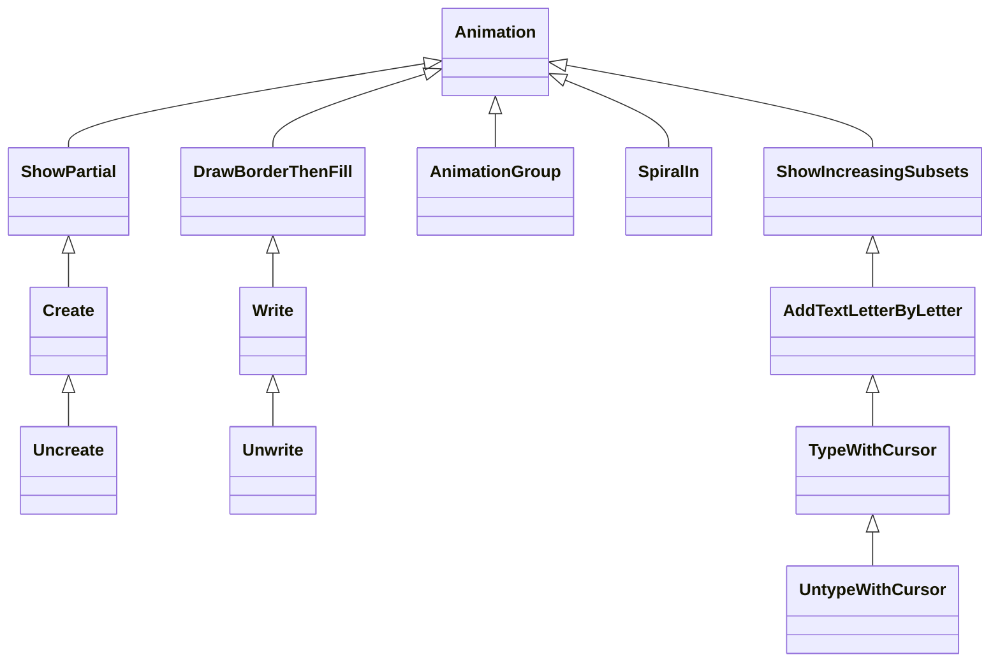
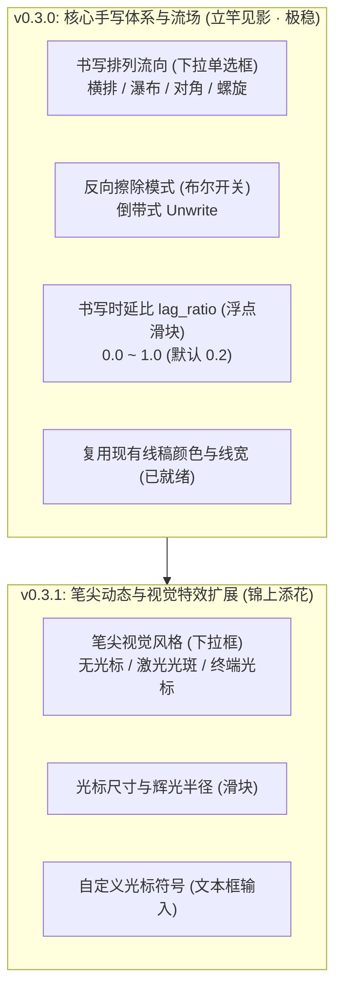

# Manim Create / Write 动效传参系统深度调研与 OBS Studio 映射规划报告

- **调研日期**：2026-11-20
- **调研上游**：[Manim Community Edition (manim/animation/creation.py & composition.py)](https://github.com/ManimCommunity/manim)
- **报告定位**：技术调研与设计规划（本轮仅做调研规划，不提前落地代码）
- **核心目标**：解构 Manim `Create`、`Write`、`Uncreate`、`Unwrite`、`TypeWithCursor`、`SpiralIn` 的全部精细传参，规划如何将其映射为 OBS Studio 的下拉框、开关、字符串、滑块配置项。

---

## 1. Manim 官方源码核心类系与参数全景解构

在 Manim 架构中，所有创建（Creation）与手绘（Writing）动效均派生自 `Animation` 基类，其核心继承谱系如下：



### 1.1 关键类与全部传参清单

#### ① `Create(mobject, lag_ratio=1.0, introducer=True, rate_func=linear, ...)`
* **`lag_ratio` (float, 默认 1.0)**：控制子几何对象（Submobjects）之间的时间错位重叠比。
  * `lag_ratio = 0.0`：所有线条和笔画完全同时生成（空间整体建构）。
  * `0 < lag_ratio < 1.0`：前一个笔画画到某一百分比时，后一个笔画启动。
  * `lag_ratio = 1.0`：前一个笔画完全画完，后一个笔画才开始（严格串行）。
* **`rate_func` (函数指针/曲线)**：进度插值函数，默认 `linear` 或 `smooth`。

#### ② `Uncreate(mobject, reverse_rate_function=True, remover=True, ...)`
* **`reverse_rate_function` (bool, 默认 True)**：时间轴倒放（将 $t \in [0, 1]$ 映射为 $1 - t$）。
* **`remover` (bool, 默认 True)**：动效结束时从屏幕中销毁几何体。

#### ③ `DrawBorderThenFill(vmobject, run_time=2, stroke_width=2, stroke_color=None, rate_func=double_smooth, ...)`
* **`stroke_width` (float, 默认 2.0)**：外边框及元素轮廓笔画粗细。
* **`stroke_color` (Color, 默认 None)**：绘制线框时的高光颜色（None 则取原物体颜色）。
* **两段式分界机制**：内部调用 `integer_interpolate(0, 2, alpha)`：
  * 前半程（$0 \le \alpha < 0.5$）：仅绘制线框；
  * 后半程（$0.5 \le \alpha \le 1.0$）：线框与填充色混合展开。

#### ④ `Write(vmobject, reverse=False, lag_ratio=None, rate_func=linear, ...)`
* **`reverse` (bool, 默认 False)**：
  * `reverse=False`：从头到尾正序书写（从左至右 / 从上至下）。
  * `reverse=True`：从尾到头逆序书写。
* **`_set_default_config_from_length()`**：
  * Manim 会根据子元素数量自动计算 `lag_ratio = min(4.0 / max(1.0, length), 0.2)`，避免字数过多时等待过长。

#### ⑤ `Unwrite(vmobject, reverse=True, ...)`
* **`reverse` (bool, 默认 True)**：
  * `reverse=True`：从最后一个字符倒序擦除至第一个字符（倒带回退）；
  * `reverse=False`：从第一个字符向后抹去（黑板擦正向拂过）。

#### ⑥ `TypeWithCursor(text, cursor, buff=0.1, keep_cursor_y=True, leave_cursor_on=True, time_per_char=0.1, ...)`
* **`cursor` (Mobject)**：跟随在当前书写字迹末端的光标图形。
* **`buff` (float, 默认 0.1)**：光标与文字的横向安全间距。
* **`keep_cursor_y` (bool, 默认 True)**：光标是否严格水平锁定当前文本行基准线（避免遇到 `g, j, p, q, y` 下伸字符时光标上下颠簸）。
* **`leave_cursor_on` (bool, 默认 True)**：动画完成时光标是否保留并进入呼吸闪烁状态。
* **`time_per_char` (float)**：单字符打字节奏间隔。

#### ⑦ `SpiralIn(shapes, scale_factor=8, fade_in_fraction=0.3, ...)`
* **`scale_factor` (float, 默认 8.0)**：子元素从无限远向中心旋转吸入时的放大比例。
* **`fade_in_fraction` (float, 默认 0.3)**：螺旋切入初期的透明度渐显区间。

## 2. 参数可行性分析、控件类型定位与制作难度评估

针对上述从 Manim 解构出的 6 大核心参数与特性，结合 OBS Studio 插件生态与 HLSL 像素着色器特性，从 **制作难度**、**推荐控件类型**、**底层实现原理** 及 **用户交互收益** 进行逐项对比评估：

| Manim 特性 / 参数名 | 制作难度评估 | 推荐 OBS 控件类型 | 推荐原因与底层实现原理 | 用户直观收益 |
| :--- | :---: | :---: | :--- | :--- |
| **`lag_ratio`**<br>(笔画推进时延系数) | 🟢 **极容易**<br>(性价比最高) | **浮点滑块**<br>`obs_properties_add_float_slider`<br>范围 `0.0 ~ 1.0`，步长 `0.05`，默认 `0.2` | **最核心的 Manim 板书质感来源**。在 HLSL 像素着色器中作为一个标量门限比对：当流场进度处于 $[t - \text{lag\_ratio}, t]$ 时呈现高亮线稿轮廓，早于 $t - \text{lag\_ratio}$ 时平滑淡入全彩画面。纯数学条件分支/平滑步进，GPU 零开销。 | 自由调节“是整幅画面几乎同时勾勒上色”，还是“先画完大半线条再逐行填充”，打造极具质感的推导延迟感。 |
| **`reverse`**<br>(反向擦除 / Unwrite) | 🟢 **极容易** | **布尔开关**<br>`obs_properties_add_bool`<br>显示名称: `反向擦除 (Unwrite)` | 在 Shader 里仅需对流场坐标或有效时间做一次翻转：`float p = reverse ? (1.0 - progress) : progress;`，或者 $S'(u, v) = 1.0 - S(u, v)$。即可直接把从左到右的正向书写变成从文末原路抹除倒带。 | 一键切换是“顺写”还是“倒擦”，直观模拟黑板擦沿演算轨迹原路倒抹的退场效果。 |
| **`rate_func`**<br>(书写速率缓动函数) | 🟢 **极容易** | **下拉单选列表**<br>`obs_properties_add_list`<br>选项：`线性手写 (Linear)`、`平滑自然起伏 (Smooth)`、`加速推入 (Ease-In)`、`急刹停顿 (Ease-Out)` | 插件在 v0.1.0 已经封装过完整的缓动数学函数曲线（`smoothstep`, `cubic-bezier` 等）。只需在进入 Shader 前由 C++ 将插值进度 $t$ 进行重映射，或直接在着色器内根据枚举执行缓动计算。 | 让手写过程摆脱死板匀速，呈现真人板书“起笔略缓、行笔流畅、落笔微驻”的呼吸感。 |
| **`stroke_color` / `stroke_width`**<br>(轮廓颜色与宽度) | 🟢 **已实现 90%**<br>(无缝直接复用) | **色彩拾色器 + 整数滑块**<br>颜色：`obs_properties_add_color`<br>宽度：`obs_properties_add_int_slider` (1~10px) | 插件在 **v0.2.0 / v0.2.1 已经实现**了完整的 GPU Sobel 轮廓算子、线宽调整与预设颜色快速选择器。在 Write 模式下，直接复用该管线作为“书写中”的笔画轮廓呈现，**无需额外研发**。 | 保持插件设计风格高度一致，无缝定制粉笔白、水色雾蓝、金色微光等手绘颜色。 |
| **`TypeWithCursor`**<br>(光标打字机跟随) | 🟡 **中等**<br>(需设计光标样式) | **组合控件**：<br>1. **光标形态 (下拉框)**：`无光标` / `高斯微光光斑` / `终端方块 █` / `打字机竖线 |`<br>2. **光标尺寸 (滑块)**：`2 ~ 32 px` | 在 Manim 中光标是一个独立的矢量 `Mobject`，跟随字符边界框移动。在 OBS 画面中，我们根据当前书写前锋的瞬时空间坐标 $(u_t, v_t)$，以该点为中心渲染一个小范围的 Alpha 形状核（发光高斯圆或微矩形），模拟笔尖光斑跟随。 | 赋予数学板书或代码推导一种“有实体光笔在实时书写”的生命力，极客风拉满。 |
| **`SpiralIn`**<br>(极坐标螺旋卷入) | 🟢 **容易 ~ 中等** | **下拉框中的一个流向选项**<br>归入 `writing_flow` (书写排列流向) 的枚举项：`极坐标螺旋卷入 (Spiral In)` | 无需做成单独的一整套繁杂参数，而是将其数学本质收纳到**书写流场流向**下拉菜单中。Shader 将屏幕 UV 转换为中心极坐标 $(r, \theta)$，流场公式设为 $S(u, v) = \frac{\theta}{2\pi \cdot N} + \frac{r}{R}$，就能自然形成向心螺旋手绘。 | 呈现极具视觉冲击力的旋涡书写感，非常适合几何学、复分析或抽象数学主题的转场。 |

---

## 3. 本轮交付策略：一次性全做 vs 分期演进对比

在 OBS 插件工程中，“是否把所有调研参数一次性全部塞入”需要权衡用户体验与交付稳定性：

### 3.1 一次性全做的风险
1. **界面过载（UI Clutter）**：如果初版一次性堆砌 10 多个参数（如光标与文字横向间距 buff、保持 y 轴 keep_cursor_y、无限远缩放 scale_factor 等），创作者打开 OBS 转场属性面板会感到眼花缭乱、难以上手。
2. **像素级与矢量级的抽象差异**：Manim 的部分参数（如 `buff`、`keep_cursor_y`）是专为排版字体轮廓设计的，在 OBS 的 1080p 全画面光栅流场中并无独立的“字符包围盒”，强行做成 string 或 float 既冗余又易产生歧义。

### 3.2 推荐交付路线：分期渐进式交付（Phased Delivery）



* **第一阶段 (v0.3.0 - 核心骨架)**：
  * 交付 **核心手写感三要素**：流场排列（含 SpiralIn）、时延上色 `lag_ratio`、反向擦除 `reverse`。
  * 复用 v0.2.1 稳定的边缘着色器管线，确保零 Bug、零掉帧、极简直观。
* **第二阶段 (v0.3.1 - 视觉扩展)**：
  * 引入 `TypeWithCursor` 前锋光标跟随系统，提供发光笔尖、方块光标和呼吸停顿选项。

---

## 4. OBS 渲染管道的核心挑战与数学映射设计

Manim 操作的是内存中由贝塞尔曲线控制点构成的矢量图形对象列表（`VMobject.submobjects`），因此可以通过 Python 遍历列表自然实现 `lag_ratio` 和 `reverse`。

但在 OBS Studio 中，输入的画面是**单帧 1080p/4K 光栅化纹理（Quad Texture）**。为了在零 CPU 负担、低于 0.4ms 的 GPU 像素着色器中实现相同的精细表现，我们需要引入 **“空间行序参数化场（Spatio-Temporal Coordinate Parameterization, $S(u, v)$）”**：

$$S(u, v) \in [0.0, 1.0]$$

每个像素在屏幕中的位置被映射为它的“书写次序（Writing Sequence Index）”：

| 排版行序模式 | $S(u, v)$ 空间数学公式 | 对应的书写与视觉体验 |
| :--- | :--- | :--- |
| **自然逐行书写** | $S(u, v) = \frac{\text{floor}(v \cdot N) + u}{N}$ | 像英文/汉语逐行演算推导，从左至右、自上而下 |
| **纵向瀑布代码流** | $S(u, v) = \frac{\text{floor}(u \cdot M) + v}{M}$ | 像终端代码流或日文/古籍纵排排版 |
| **对角光幕扫演** | $S(u, v) = \frac{u + v}{2.0}$ | 极具几何科技感的光刃斜向扫过 |
| **螺旋聚散 (SpiralIn)** | $S(u, v) = \frac{\text{atan2}(v-0.5, u-0.5)}{2\pi} + 2 \cdot \|(u, v) - (0.5, 0.5)\|$ | 模拟 Manim `SpiralIn` 螺旋卷入黑板 |
| **中心发散 / 向心汇聚** | $S(u, v) = 2 \cdot \|(u, v) - (0.5, 0.5)\|$ | 经典的雷达式由内向外绽放 |

---

## 5. OBS Studio 原生 UI 配置项映射方案 (v0.3.0 设计蓝图)

在 OBS 中，`obs-properties` 接口支持以下四类标准配置控件。我们将 Manim 的原生参数进行如下无损映射：

### 5.1 下拉选择框（`obs_properties_add_list`）
* **书写时空流向（Writing Direction / Flow）**：
  * `0`: 自然逐行演算 (Left-to-Right, Top-to-Bottom) —— *[默认推荐]*
  * `1`: 纵向代码流 (Top-to-Bottom, Left-to-Right)
  * `2`: 对角科技光幕 (Top-Left to Bottom-Right)
  * `3`: 极坐标螺旋卷入 (Spiral Inward)
  * `4`: 放射扩散 (Center Outward)
* **笔尖与光标形态（Pen Tip / Cursor Style）**：
  * `0`: 高光落笔火花耀斑 (Laser Pen Sparkle) —— *[默认推荐]*
  * `1`: 复古终端闪烁方块 (`TypeWithCursor` 方块光标 `█`)
  * `2`: 打字机经典竖线 (`TypeWithCursor` I-Beam `|`)
  * `3`: 傅里叶 Epicycles 旋转圆环链 (Fourier Circle Chain)
  * `4`: 纯净线条 (无附加光标)

### 5.2 布尔开关单选（`obs_properties_add_bool`）
* **方向反向（`reverse_direction`）**：
  * 对应 Manim `reverse=True`。
  * 开启后：正向书写变为倒序反写；黑板擦从末端倒退擦除。
* **落笔行高锁定（`lock_cursor_line`）**：
  * 对应 Manim `keep_cursor_y=True`。
  * 光标平稳锁定在行基线，不随字母局部上下跳跃。
* **转场完结保留光标（`leave_cursor_on`）**：
  * 对应 Manim `leave_cursor_on=True`。
  * 转场结束后，笔尖光标在画面停留呼吸闪烁 0.4 秒后再隐去。
* **逐字顿挫感（`typewriter_stepped`）**：
  * 开关：开启后从平滑模拟笔画切换为打字机般的阶梯式跳动感。

### 5.3 浮点与整数滑块（`obs_properties_add_float_slider`）
* **时差滞后比例（`lag_ratio`）**：
  * 范围：`0.01` ~ `0.50`，步长 `0.01`，默认 `0.18`。
  * 控制“当前行还在写，上一行何时开始填充真实色彩”的时差。
* **笔尖耀斑强度（`pen_tip_glow`）**：
  * 范围：`0.0` ~ `4.0`，步长 `0.1`，默认 `1.8`。
  * 模拟粉笔/激光在落笔处的发光扩散半径。
* **排版行数分块（`row_count`）**：
  * 范围：`2` ~ `32` 行，步长 `1`，默认 `8` 行。
  * 决定全屏分为几行文字/代码进行逐行扫描。

### 5.4 字符串配置项（`obs_properties_add_text`）
* **自定义光标字符（`custom_cursor_char`）**：
  * 当光标样式选择“自定义文字光标”时生效；
  * 创作者可自由填入：`_`、`|`、`>`、`█`、`λ`、`$`，满足黑客终端、LaTeX 提示符等个性化直播风格。

---

## 6. OBS 设置面板交互线框原型草案 (Wireframe Prototype)

```
[ 入场动效 (Entrance Animation) ]
  [ Write (手绘板书光笔演算) ▼ ]

--- ✍️ Manim Write 精细书写配置 ---

[ 书写时空流向 (Writing Flow) ]
  [ 自然逐行演算 (左至右·逐行向下) ▼ ]

[ 逆向反转书写 (Reverse Direction) ]
  [ 开关: [关] ] (开启后从右下向左上反向书写)

[ 笔尖与光标风格 (Pen Tip / Cursor) ]
  [ 高光落笔耀斑 (Laser Sparkle) ▼ ]

[ 笔画时差滞后比 (Lag Ratio) ]
  [ 0.01 ───────────●────────── 0.50 ] (0.18)

[ 笔尖光斑强度 (Tip Glow Multiplier) ]
  [ 0.0 ──────────────●──────── 4.0 ] (1.80)

[ 排版行数密度 (Row Scan Density) ]
  [ 2 ───────────────●───────── 32 ] (8 行)

[ 动画结束保留光标微闪 (Leave Cursor On) ]
  [ 开关: [开] ]
```

---

## 7. 结论与总结建议

1. **工程可行性评级**：⭐⭐⭐⭐⭐（极高）。
   核心参数均可被数学归一化为空间坐标标量场与时间因子的组合，完全由现有 GPU HLSL 像素着色器单 Pass 完成，不需要占用 CPU 计算，不掉帧。
2. **体验丰富度**：
   通过上述 **2个下拉框 + 3个布尔开关 + 3个滑块 + 1个字符串输入** 的组合，创作者可以随心所欲调制出：
   * **经典 3Blue1Brown 数学公式黑板推导**（自然逐行 + 激光光斑 + 水色雾蓝）；
   * **极客 Linux 黑客打字机**（纵向代码流 + 终端方块光标 `_` + 阶梯顿挫 + 赛博霓虹青）；
   * **科技发布会光幕展开**（对角光幕 + 逆向擦除 + 冰蓝高光）。
3. **交付节奏定调**：
   **严控复杂度，分期落地**：
   * **v0.3.0** 锁定手写感核心骨架：`writing_flow`（下拉）、`reverse`（布尔开关）、`lag_ratio`（滑块），直接复用现有的轮廓颜色与宽度；
   * **v0.3.1** 扩展笔尖粒子光斑、打字机光标与文本自定义字符。
